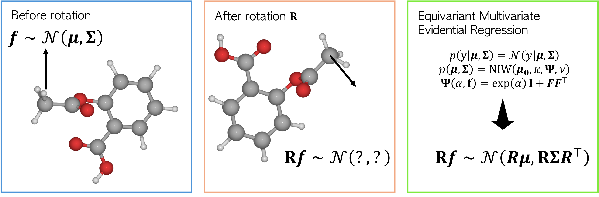
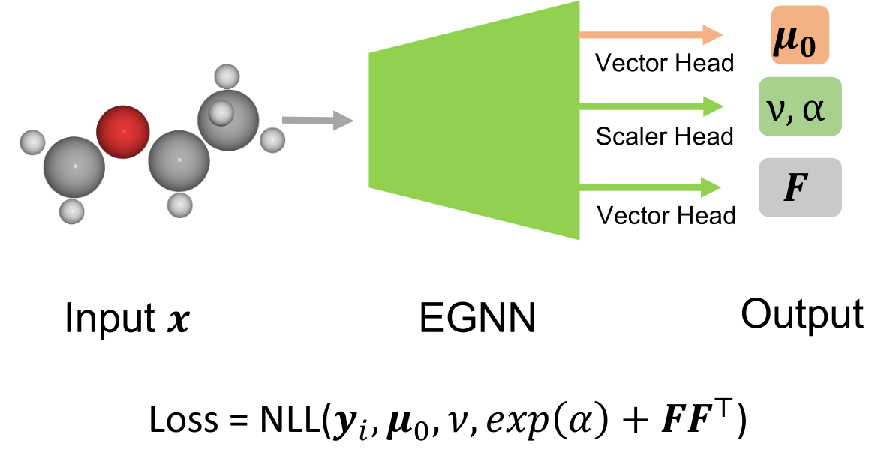

[](https://openreview.net/forum?id=ey4IT8N8rl)
[](https://openreview.net/forum?id=ey4IT8N8rl)

# Preserving Geometric Symmetry in Uncertainty Estimation for Molecular Forces

This branch (`qm7x`) contains the code for the **QM7X dipole-moment** experiments of
**"Preserving Geometric Symmetry in Uncertainty Estimation for Molecular Forces"**
(PaiNN, NequIP and MACE backbones). The MD17 force experiments are on the
`main` branch.

The project studies uncertainty estimation for equivariant vector-valued molecular
properties such as atomic forces and dipole moments. The main method is
Equivariant Multivariate Evidential Regression (EMER), which parameterizes the
Normal-Inverse-Wishart scale matrix as

```math
\boldsymbol{\Psi}(\alpha,\mathbf{F})=\exp(\alpha)\,\mathbf{I}+\mathbf{F}\mathbf{F}^{\top}
```

where `alpha` is an invariant scalar and `F` is an equivariant low-rank vector
feature matrix. This keeps the predicted covariance positive definite and
equivariant under 3D rotations.



For a rotation `R`, the predicted distribution transforms as `R mu` and `R Sigma R^T`, i.e. the uncertainty rotates together with the predicted vector.

## Framework



On top of the vector head that predicts the target, two uncertainty heads output the NIW parameters: a scalar head for `nu` and `alpha`, and a vector head for `F`. The network is trained end-to-end with the evidential negative log-likelihood. With `-D` variants, dropout is active during training only and acts as a regularizer.

## What is included

- MER and EMER heads for PaiNN, NequIP and MACE, each with and without dropout
  (`-D`).
- Baselines: plain backbone, MC dropout, and deep ensembles
  (`parallel_lightning_ens.py`).
- QM7X dipole dataset with the planar-alignment / rotation-shift OOD protocol
  (`qm7x_ood`) and the unrotated protocol (`qm7x`).
- Mahalanobis-distance calibration metrics (MCal, max RCal, max NLL) for vector
  uncertainty.
- Training and evaluation based on PyTorch Lightning.
- A minimal vendored subset of `ocpmodels` from the Open Catalyst Project.

## Repository layout

```text
.
|-- parallel_lightning.py                 # Main train/evaluate entry point
|-- parallel_lightning_ens.py             # Deep-ensemble entry point
|-- training_lightning.py                 # Lightning training modules
|-- ue.yml                                # Conda environment
|-- configs/qm7x/{painn,nequip,mace}/     # One config per method (see below)
|-- uncertainty_ai/
|   |-- dataset/                          # QM7X loaders (QM7xDPAligned, DPRotatedDataset)
|   |-- loss/                             # Scalar and vector evidential losses
|   |-- metrics/                          # Calibration and NLL metrics
|   `-- models/                           # PaiNN, NequIP, MACE and their MER/EMER/dropout variants
|-- ocpmodels/                            # Minimal vendored OCP subset
`-- train_scripts/train_qm7x.sh           # Run all methods of one backbone
```

## Third-party code

`ocpmodels/` contains the small subset of the legacy Open Catalyst Project
codebase (`https://github.com/Open-Catalyst-Project/ocp`, MIT license, see
`ocpmodels/LICENSE`) that this repository imports: `BaseModel`, the target
`Normalizer`, and the registry, typing and utility helpers they depend on. The
original repository has since moved to Fair-Chem, whose API no longer preserves
these import paths, so the files are kept here unchanged.

## Installation

```bash
conda env create -f ue.yml
conda activate ue
```

Run all commands from the repository root. The entry scripts add the repository
root to `PYTHONPATH` internally, so an editable install is not required.

## Data

Place the raw QM7X HDF5 files under `dataset/QM7X/raw/`:

```text
dataset/QM7X/raw/1000.hdf5
dataset/QM7X/raw/2000.hdf5
...
dataset/QM7X/raw/8000.hdf5
```

The QM7X dataset is available from <https://doi.org/10.5281/zenodo.4288677>
(Hoja et al., 2021). Processed files are generated automatically on first use.
Only the global-minima conformers are used.

## Running experiments

Configs are named by method and live in `configs/qm7x/<backbone>/`:

| file | method |
|---|---|
| `backbone.yml` | plain backbone |
| `drop.yml` | MC dropout |
| `mer.yml`, `mer_d.yml` | MER, MER-D |
| `emer.yml`, `emer_d.yml` | EMER, EMER-D |

`-D` means the model is trained with dropout (a regularizer only). The dropout
ratio is 0.1 for PaiNN and NequIP and 0.4 for the `-D` variants of MACE
(MC dropout uses 0.1 for all backbones).

### Single run

```bash
python parallel_lightning.py --config configs/qm7x/painn/emer.yml
```

Use `--test True` for a smoke test on a small subset with at most 10 epochs.
Each config trains seeds 1, 10, 100, 1000 and 10000.

### All methods of one backbone

```bash
bash train_scripts/train_qm7x.sh painn          # or nequip / mace
bash train_scripts/train_qm7x.sh mace emer emer_d
```

### Unrotated protocol

The configs use `dataset: qm7x_ood` (train on planar-aligned molecules, test on
rotated ones). Set `dataset: qm7x` to train and test without the rotation shift.

### Deep ensembles

Ensembles are built from the backbone config; `--n_ensemble` sets the number of members:

```bash
python parallel_lightning_ens.py --config configs/qm7x/painn/backbone.yml --n_ensemble 5
```

### Submitit or Slurm execution

On clusters supported by `submitit`, add `--submitit True`.

## Outputs

Each run writes results to:

```text
runs/<month-day>/<dataset>_<method>_<timestamp>/
```

Important files include:

- `results.txt`: per-seed metrics plus mean and standard deviation.
- `dp_pred_*.pt`, `dp_true_*.pt`, `dp_stds_*.pt`: dipole predictions, labels and
  predicted covariance.
- TensorBoard and CSV logger outputs under the run directory.

The reported metrics include dipole MAE, Mahalanobis calibration score (MCal),
dimension-wise calibration (max RCal) and dimension-wise NLL (max NLL).

## Citation

If you use this code, please cite:

```bibtex
@inproceedings{li2026preserving,
  title     = {Preserving Geometric Symmetry in Uncertainty Estimation for Molecular Forces},
  author    = {Li, Xinyu and Zhang, Zhen and Huang, Jiayu and Steinberg, Daniel M. and Yao, Lina and Shi, Javen Qinfeng},
  booktitle = {The Fortieth Annual Conference on Neural Information Processing Systems},
  year      = {2026},
  url       = {https://openreview.net/forum?id=ey4IT8N8rl}
}
```
